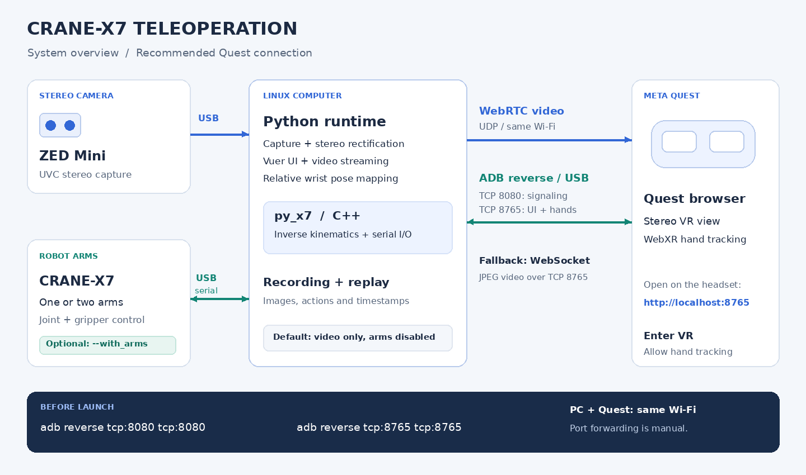

# CRANE-X7 Teleoperation

VR teleoperation for CRANE-X7 arms on Linux, with stereo video, relative hand-pose
control, episode recording, and action replay.

**Recommended Quest connection:** use ADB reverse forwarding to access the
computer-hosted web interface from the Quest browser. Connect the Quest and the
computer to the **same Wi-Fi network** for the default WebRTC video connection,
and connect the headset over USB for ADB. The Linux installer includes ADB;
[Android SDK Platform-Tools](https://developer.android.com/tools/releases/platform-tools)
is also available separately. Users with another suitable headset/network setup
may use their own connection method.

**Run the forwarding commands manually before launching.** The launcher does not
set up port forwarding:

```sh
adb reverse tcp:8080 tcp:8080
adb reverse tcp:8765 tcp:8765
```

## System overview



[Vector version of the diagram](docs/images/system-overview.svg)

The ZED Mini supplies stereo images to the Linux computer. Python handles camera
capture, rectification, the Vuer interface, video transport, and hand-pose mapping.
The C++ `py_x7` extension computes inverse kinematics and communicates with the
robot arms. The Quest browser displays the stereo view and sends hand tracking
back to the computer.

- **WebRTC is the default video transport.** Video uses UDP over the shared
  network. ADB reverse forwards the webpage and signaling connections; it does
  not tunnel WebRTC UDP video. The Wi-Fi network must allow communication between
  the computer and headset, without client isolation or blocked media traffic.
- **WebSocket is a fallback.** It sends stereo JPEG images through TCP port 8765
  and can be selected with `--video_transport websocket`.
- **Robot control is disabled by default.** The initial run displays video only,
  so you can adjust camera placement and viewing angles without connecting or
  moving the arms.

## Hardware and software

| Component | Requirement |
| --- | --- |
| Computer | Linux with V4L2; Ubuntu 24.04+ or Debian with Python 3 and venv packages for automated system installation |
| Headset | Meta Quest with a WebXR-capable browser and hand tracking |
| Camera | ZED Mini operating as a UVC stereo camera |
| Robot | One or two CRANE-X7 arms, connected through USB serial when control is enabled |
| Python | Python 3.12 or 3.13; the installer can download a project-local compatible interpreter |
| Native dependencies | C++17 compiler, CMake 3.16+, Ninja, Eigen3 3.3+, yaml-cpp, Python development headers and pthread; OpenMP is optional |

CUDA and the ZED SDK are not required for capture and CPU stereo rectification.
Internet access is needed during setup to obtain packages and third-party sources.

## Install

Clone the repository, enter its root directory, and run:

```sh
./scripts/setup_linux.sh
```

The script installs the compiler, CMake, Ninja, Eigen, yaml-cpp, Python development
tools, OpenMP runtime, GLib, ADB, and V4L2 utilities through `apt-get`. It then:

1. Uses Python 3.12/3.13, or downloads a project-local Python 3.13.14 through uv
   when the default interpreter is incompatible, without replacing system Python.
2. Creates `.venv` and installs the packages in [requirements.txt](requirements.txt).
3. Downloads pinned versions of DynamixelSDK and `rt_manipulators_cpp` into
   `third_party/`, verifies their SHA-256 hashes, and applies the local library patch.
4. Runs CMake to build `python/py_x7*.so` and checks that the module can be imported.

The extension filename contains a Python ABI suffix; Python imports it as `py_x7`.
Installation does not connect the camera or robot.

### Modified third-party library

**This project uses a modified `rt_manipulators_lib`.** The changes add timestamped
position feedback for recording, modifying `hardware.hpp` and `hardware.cpp` and
adding `recording_feedback.hpp`.

**`setup_linux.sh` applies these modifications automatically.** The patch is stored
in [third_party/patches/recording-feedback.patch](third_party/patches/recording-feedback.patch),
and the source revisions and checksums are in
[third_party/sources.json](third_party/sources.json). Replacing the library with an
unmodified upstream checkout would omit the required feedback interfaces.

Existing dependency directories without a matching installer marker are not
overwritten. Move any such directory aside before rerunning setup. Upstream
license files and source headers are retained.

### Other environments and rebuilding

On another Linux distribution, install equivalent system development packages
first, including ADB for the recommended headset connection, then run:

```sh
./scripts/setup_linux.sh --skip-system
```

This skips only system package installation; Python dependencies, third-party
sources, patching, and compilation are still handled by the script.

To choose an existing compatible interpreter:

```sh
PYTHON=/usr/bin/python3.12 VENV_DIR="$PWD/.venv" ./scripts/setup_linux.sh
```

A custom interpreter needs matching development headers. Use the same `VENV_DIR`
for installation, rebuilding, and launch. To rebuild the C++ extension:

```sh
./scripts/build.sh
```

`BUILD_DIR`, `BUILD_JOBS` (default: 2), and `CMAKE_PREFIX_PATH` can customize the
build location, parallelism, and native dependency search paths. Use a fresh build
directory when changing Python or the compiler.

## First run: video only

### 1. Prepare the camera

Connect the ZED Mini and identify its device:

```sh
v4l2-ctl --list-devices
v4l2-ctl --device=/dev/video0 --list-formats-ext
```

Use the serial number of your own camera. The bundled factory calibration is for
serial `10029943` only. For another unit, `--zed_serial` selects its calibration;
the resolver searches the project cache and `/usr/local/zed/settings`, then
retrieves the factory file if needed. You can also provide
`--zed_calibration_file /absolute/path/SNxxxx.conf` with the matching serial.

### 2. Connect the Quest and forward both ports

Enable developer mode on the Quest, connect it by USB, and authorize the computer
in the headset. Keep the computer and Quest on the same Wi-Fi network. Check that
ADB sees an authorized device and establish the reverse forwarding:

```sh
adb devices
adb reverse tcp:8080 tcp:8080
adb reverse tcp:8765 tcp:8765
adb reverse --list
```

| Forwarded port | Purpose |
| --- | --- |
| TCP 8080 | WebRTC signaling |
| TCP 8765 | Vuer webpage, scene updates, and hand tracking; also JPEG video in WebSocket mode |

Reapply the forwarding commands if the ADB connection or device restart clears
them. Both commands are separate from the project launcher.

### 3. Launch and open the headset browser

```sh
./scripts/run.sh teleop --camera_device /dev/video0 --zed_serial YOUR_ZED_SERIAL
```

Replace `YOUR_ZED_SERIAL` with your camera's serial number. This starts the default
WebRTC video-only mode. **You do not need to connect or operate the robot arms on
your first run.** Adjust the camera angle and stereo view before enabling control.

Open **`http://localhost:8765` in the Quest browser**, enter VR, and allow hand
tracking when prompted. Users familiar with Quest should recognize the browser
and VR interaction flow. A Quest browser operation video can be added later if
needed.

To use the fallback transport:

```sh
./scripts/run.sh teleop --video_transport websocket \
  --camera_device /dev/video0 --zed_serial YOUR_ZED_SERIAL
```

Users choosing another connection method should provide the corresponding browser
access and signaling routes; the current viewer uses localhost signaling URLs.

## Enable robot control

Before using an arm connected at `/dev/ttyUSB0`, grant access to the serial device:

```sh
sudo chmod 666 /dev/ttyUSB0
```

Substitute the actual device path. For a second arm on `/dev/ttyUSB1`, apply the
same command to that device. These permissions grant all local users read/write
access and may reset when the device is reconnected; use them on a trusted machine.

For a single arm on the right side:

```sh
./scripts/run.sh teleop --with_arms \
  --left_port /dev/unused-arm --right_port /dev/ttyUSB0 \
  --zed_serial YOUR_ZED_SERIAL
```

The nonexistent port for the unused side is skipped. For two arms:

```sh
./scripts/run.sh teleop --with_arms \
  --left_port /dev/ttyUSB0 --right_port /dev/ttyUSB1 \
  --zed_serial YOUR_ZED_SERIAL
```

`--with_arms` explicitly enables robot connections and hand-based control. Each
hand's first valid pose establishes its relative reference. Wrist poses drive
position and rotation, while landmarks control the gripper. The X7 forward axis
is +X. Robot configuration and link geometry are stored in `cpp/config/`.

Check the port mapping and keep the workspace clear before enabling the arms.
Keep the physical stop or power control accessible. Ctrl+C exits the application;
it is not a hardware emergency stop. The runtime does not provide collision
avoidance or force-controlled grasping.

## Key options

| Option | Purpose | Default |
| --- | --- | --- |
| `--with_arms` | Enable robot connections and control | Disabled |
| `--video_transport` | `webrtc`, or `websocket` as fallback | `webrtc` |
| `--fps` | Requested camera frame rate | 30 |
| `--stream_fps` | Target video transmission frame rate | 30 |
| `--camera_device` | Camera index, device path, or automatic selection | `auto` |
| `--camera_width`, `--camera_height` | Total stereo SBS capture dimensions | 1344 × 376 |
| `--arm_home_position X Y Z` | Relative-control reference position in meters | 0.35 0.0 0.30 |
| `--arm_translation_gain` | Hand-to-arm translation scale | 1.0 |
| `--filter_bad_frames` | V4L2 error, short-frame, and zero-fill filtering for YUYV capture | Disabled |

Camera and transmission frame rates accept positive integers without a 30 FPS
cap. Actual throughput depends on the camera mode, USB bandwidth, and processing
load. For HD720 stereo capture with a 60 FPS target:

```sh
./scripts/run.sh teleop --camera_width 2560 --camera_height 720 \
  --fps 60 --stream_fps 60 --zed_serial YOUR_ZED_SERIAL
```

Use `./scripts/run.sh teleop --help` for all options.

## Record, inspect, and replay

Record observations and submitted actions while controlling one arm:

```sh
./scripts/run.sh teleop --with_arms \
  --left_port /dev/unused-arm --right_port /dev/ttyUSB0 \
  --record_mode dataset --record_dir "$PWD/data" --zed_serial YOUR_ZED_SERIAL
```

Recording is off by default. Episodes contain metadata, samples, stereo videos,
and frame indexes. `--record_mode ik_analysis` includes inverse-kinematics
information. Allow the writer to finish when exiting.

Inspect an episode without opening robot connections:

```sh
./scripts/run.sh inspect /absolute/path/to/episode
./scripts/run.sh inspect /absolute/path/to/episode --step 0
```

Check recorded actions before replay:

```sh
./scripts/run.sh replay /absolute/path/to/episode --dry-run
```

Replay uses the controller without starting the camera or VR interface:

```sh
./scripts/run.sh replay /absolute/path/to/episode --side right \
  --right_port /dev/ttyUSB0 --speed 0.5
```

The default initialization sends the first accepted targets. `--init home` uses
the recorded teleoperation home pose; `--init none` skips initialization. Replay
uses recorded joint/gripper targets in radians and recorded timing. Reducing
speed changes timing, not target magnitudes. Prepare the arm and workspace before
running replay; accepted commands do not confirm physical arrival.

## Project layout

| Path | Contents |
| --- | --- |
| `cpp/` | Controller, inverse kinematics, Python bindings, and robot configuration |
| `python/` | Teleoperation, camera/video, recording, inspection, and replay |
| `scripts/` | Installation, dependency fetching, build, and launch scripts |
| `third_party/sources.json` | Pinned dependency revisions and archive hashes |
| `third_party/patches/` | Recording-feedback modifications to the RT library |
| `docs/images/` | System overview diagram |
| `licenses/` | Preserved upstream license texts |

## License and acknowledgments

Project contributions are licensed under [Apache-2.0](LICENSE). Original copyright
and license terms remain applicable to upstream material. See [NOTICE](NOTICE)
and [THIRD_PARTY_NOTICES.md](THIRD_PARTY_NOTICES.md) for sources, modification
notices, inherited acknowledgments, and the OpenTeleVision citation.

- [RT Corporation / CRANE-X7](https://rt-net.jp/products/crane-x7/): portions of
  the sample inverse-kinematics implementation are reused or modified.
- [rt_manipulators_cpp](https://github.com/rt-net/rt_manipulators_cpp): provides
  the robot library used under `third_party/`, with the recording-feedback patch
  applied automatically during setup.
- [ROBOTIS DynamixelSDK](https://github.com/ROBOTIS-GIT/DynamixelSDK): provides
  the servo communication implementation.
- [OpenTeleVision](https://github.com/OpenTeleVision/TeleVision): the Python
  teleoperation implementation adapts its code and workflow. Its original
  acknowledgments and licensing references are preserved.
